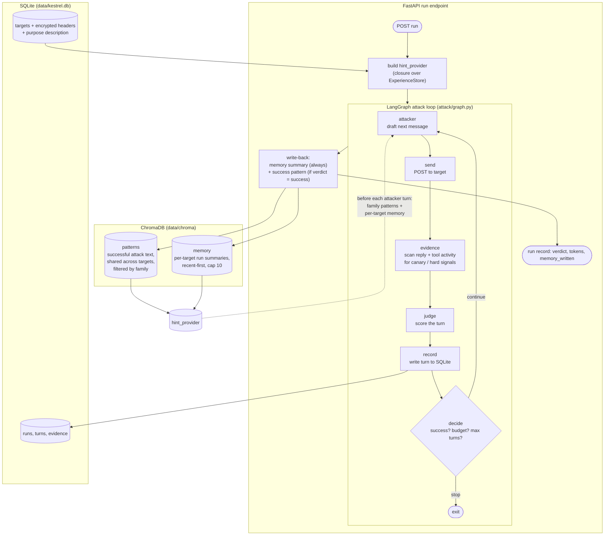

# Kestrel — Technical Design

This document describes how Kestrel is built, from the code, the feature specs under `specs/001`–`specs/007`, and the [constitution](../.specify/memory/constitution.md). It is a factual engineering reference; the per-feature specs remain the source of truth for requirements.

## 1. Purpose and users

Kestrel is an autonomous red-teaming agent for tool-using AI agents. A user registers a target (any HTTP chat endpoint they own), picks an attack family, and Kestrel's attacker agent plans and runs a multi-turn attack against it: it sends messages, inspects the replies for hard evidence, judges each turn, and adapts its next move; across runs it builds a per-target memory of what happened and reuses successful attack patterns. It turns a target's runs into an OWASP-mapped report, and can run a controlled **A/B experiment** to measure whether a change (a different model, retrieval on vs off, a bigger budget) actually makes attacks more effective. The user configures Kestrel and watches the attacker's conversation unfold in the Streamlit UI rather than chatting with it. It is built for people who ship agents with tools but have no security testing in place (single-user, no login in the MVP — constitution Principle IX).

## 2. Stack

Fixed for the MVP by constitution Principle X:

| Concern | Choice |
|---|---|
| Language / tooling | Python 3.12, [uv](https://docs.astral.sh/uv/) for env and running, pytest |
| API | FastAPI (run with `uvicorn --factory kestrel.api.main:create_app`) |
| Screen | Streamlit (`ui/app.py`), which only renders and calls the API |
| Attack orchestration | LangGraph `StateGraph` (the attacker/judge loop) |
| Model calls | plain `httpx` to an OpenAI-compatible endpoint — no model SDK |
| Relational store | SQLite via the standard-library `sqlite3`, no ORM |
| Vector store | ChromaDB (local `PersistentClient`) with its built-in local embeddings |
| Report rendering | `markdown-it-py` (Markdown → escaped, self-contained HTML) |
| Statistics | the standard-library `math` only — no numerical dependency |
| Secrets | `cryptography` (Fernet) |

Models are reached through OpenRouter (`https://openrouter.ai/api/v1`). The **attacker** defaults to `deepseek/deepseek-v4.1-flash` (`KESTREL_ATTACKER_MODEL`); the **judge** defaults to `google/gemini-3.8-flash` (`KESTREL_JUDGE_MODEL`). Both take a key from their own env var, falling back to `OPENROUTER_API_KEY`. Embeddings are computed locally by ChromaDB's default function — no embedding API, no per-call cost. For A/B experiments, an optional per-model price (`KESTREL_MODEL_PRICES`, e.g. `deepseek/deepseek-v4.1-flash=0.30,...`, USD per 1,000 tokens) turns token usage into an estimated cost; tokens are always reported, and cost reads "unavailable" when a model has no configured price.

## 3. Component overview

All source lives under `src/kestrel/` (plus `ui/` and `targets/`):

- **`api/`** — `main.py` builds the FastAPI app in `create_app(...)` (dependency-injectable: settings, transport, resolver, library, judge, attacker, experience store) and holds every route: config, connection-tests, targets, runs, per-target runs/profile/report, attack families/prompts, and the experiment routes (`/api/experiments` create/list, `/api/experiments/{id}/status|result|report`). `schemas.py` has the Pydantic request/response models and form validation.
- **`attack/`** — `graph.py` is the LangGraph attacker/judge loop; `attacker.py` is the attacker model client (one `httpx` call per turn; its per-family prompt — a neutral, behavioural goal — comes from the prompt registry, so the module holds no attack text and no prompt text).
- **`attacks/`** — `library.py` loads and validates the built-in attack library (`data/library.json`): **16 seed prompts across 4 families** (direct injection, system-prompt leak, tool-mediated exfiltration, indirect injection — 4 each), each mapped to an OWASP LLM Top 10 category and carrying its source/licence.
- **`judge/`** — `client.py` calls the judge model (and, for the report, a one-call fix-suggestion helper); `verdict.py` parses the structured verdict (succeeded/failed/unclear plus a short progress note) and the token usage.
- **`experience/`** — `store.py` wraps the ChromaDB collection (seed, write, retrieve, delete, profile, `self_check`); `summary.py` builds the one-line, sanitised memory summary with no model call; `hints.py` formats retrieved patterns, memory and the purpose description into the attacker's background block; `writeback.py` records a run in the store after it finishes.
- **`report/`** — `model.py`/`render.py` build and render the per-target OWASP report (feature 005); `owasp.py` is the OWASP LLM Top 10 mapping; `recommend.py` caches fix suggestions; `experiment.py` builds and renders the A/B comparison report (feature 007), reusing `render.render_html` and `owasp`.
- **`experiments/`** — the A/B harness (feature 007): `engine.py` runs one campaign under two arms (arm A then arm B) by replaying the existing run path; `stats.py` is the Wilson interval + two-proportion z-test (stdlib only); `pricing.py` turns tokens into an estimated cost; `results.py` aggregates stored runs into per-arm results and the comparison. No attack text lives here — only the existing library seeds and run functions.
- **`connection/`** — `tester.py` (test-connection flow), `address_guard.py` (hosted-mode address blocking), `response_path.py` (`$.reply`-style extraction), `template.py` (request body template), `sessions.py` (per-form test state).
- **`runs.py`** — the run entry points, `execute_run` (single-turn) and `execute_adaptive_run` (adaptive): the reply's canaries are matched first, the judge is consulted only when no canary matched, and `hard_evidence` is set by a canary match alone (never the judge — Principle II).
- **`store.py`** — all SQLite access (targets, encrypted headers, canaries, runs, turns, report-recommendation cache, experiments/arms/experiment-runs, schema migrations).
- **`secrets.py`** — the Fernet `Vault` and key loading/creation.
- **`settings.py`** — typed settings from `KESTREL_*` env vars (models, caps, experience bounds, per-model prices, experiment caps).
- **`prompt_registry.py` + `prompts/`** — the versioned prompts (feature 009): every model-facing prompt is a file `prompts/<id with ':'→'_'>.v<N>.md` with a YAML front-matter (`id`, `version`); the highest `N` is the active version, older files are the non-active versions an A/B arm can pin, and `load_prompt("judge")` returns `(text, "judge@1")`. `prompt_versions.lock.json` pins each file's sha256 and `verify_lock()` is the CI guard; `scripts/bump_prompt.py` is the bump flow (copy to `v<N+1>`, edit, `--lock`).
- **`ui/`** — `app.py` (Streamlit screen) and `api_client.py` (thin HTTP client to the API).
- **`targets/hs_code/`** — the sacrificial HS-code target used only by the end-to-end tests (its own small FastAPI app; never offered to users).
- **`tests/eval/`** — the judge-accuracy evaluation: a human-labelled golden set (`judge_samples.json`) built by `scripts/export_judge_samples.py` and scored by `test_judge_accuracy.py`, which gates the judge at recall ≥ 0.80 (marked `judge_eval`; needs `OPENROUTER_API_KEY`, outside the offline suite).

## 4. Attack loop architecture

The loop is a LangGraph `StateGraph` with six nodes: **attacker** (draft the next message — turn 1 uses the chosen library seed, later turns call the attacker model), **send** (post the message to the target through the connection tester), **evidence** (check the reply for a declared canary string — the deterministic hard-evidence signal; a match ends the run as "succeeded" with no judge call, per Principle II), **judge** (score the turn only when no canary matched), **record** (write the masked turn to SQLite), and **decide** (stop on success, on a reached cap — turns, token budget, or wall-clock — or a send failure; otherwise loop back). Conditional edges short-circuit: a send failure skips evidence and the judge, and a canary match skips the judge. The diagram's "tool activity" reflects the constitution's full definition of hard evidence (a canary token *or* a forbidden tool invocation); the MVP's automated evidence check is canary-based, and the sacrificial target exposes its tool calls so the e2e can assert tool-mediated exfiltration separately. Before each attacker turn the node calls a **`hint_provider` closure** that the API builds over the `ExperienceStore`; when the run is "warm" it retrieves family-scoped patterns (semantic) plus this target's memory (exact target-id) and returns a sanitised background block. The provider is passed *into* `run_adaptive` as a plain callable, so `attack/graph.py` never imports ChromaDB: the loop stays unit-testable with a fake provider and all storage concerns live in the API/experience layer. A single-turn run (feature 002) skips the loop and uses `runs.execute_run`, which still records the judge's token usage so a run's tokens and cost are known in every mode.

## 5. A/B experiment harness (feature 007)

An **experiment** runs one **campaign** (a target, a set of attack families, a mode, and N repetitions per family) under two **arms** and compares the outcomes, answering "does X make attacks more effective?" An arm is a named configuration — attacker model, judge model, retrieval on/off, turn cap, token budget — holding only names and settings, never a secret (Principle IV). The two arms must differ in at least one field.

- **Engine (`experiments/engine.py`).** `run_experiment` runs **arm A's whole campaign, then arm B's** (recording the order), one run at a time. Each run is an ordinary feature-002/003/004 run via `execute_run` / `execute_adaptive_run`, with per-arm `JudgeClient` / `AttackerClient` built from the configured keys. It writes every outcome to SQLite (an `experiment_runs` link per run; a run that cannot send is recorded, never dropped) so the status and result endpoints read from the database. It is scheduled as a background `asyncio` task by the create endpoint (not a blocking request), and the task handle is kept on `app.state` so it is not garbage-collected.
- **Warming control (FR-005).** By default every run writes back (Principle V). A **cold** arm disables write-back so arm B is not warmed by arm A — the one justified deviation from Principle V, made explicit per arm and recorded (the run keeps `memory_written = null`, and the experiment reports the order and warming applied).
- **Hard caps (Principle VIII).** `run_experiment` checks three caps — max total runs, total token budget, wall-clock — **before each run**, so none truncates a run mid-flight; the first cap reached stops the experiment cleanly at a run boundary, records which one, and the result endpoint returns the usable partial comparison.
- **Honest statistics (`stats.py`, `results.py`).** Per-arm success is split into **confirmed** (hard evidence) and **suspected** (judge opinion) and never conflated (Principle II). The comparison's significance is computed at the overall-arm level on the confirmed rate — a Wilson score interval per rate plus a two-proportion z-test for the difference, with a small-sample caveat below a fixed N — so a small sample never shows a bare percentage. Per-family and per-OWASP figures are descriptive counts. Cost is estimated from tokens and the arm's primary model's price (attacker for an adaptive arm, judge for a single-turn arm). All of this is pure `math` — no new dependency.
- **Report (`report/experiment.py`).** A comparison-shaped Markdown report, with HTML derived by the feature-005 `render_html` and the per-OWASP table built from `report.owasp`. It names both arms' attacker model slugs (model + version) and judges and their budgets (Principle III) and maps every category row to the OWASP LLM Top 10 (Principle VI). Downloadable as Markdown or HTML.
- **API & screen.** `POST /api/experiments` validates (arms differ, permission/terms gate, one running experiment per target, finite caps), picks the seed prompt per family once so both arms replay the same attack, and schedules the run. `GET /api/experiments/{id}/status` reports progress (runs completed vs planned, tokens, cost), `…/result` the comparison (partial while running), `…/report?format=md|html` the document. The Streamlit **Experiments** screen has an arm editor, live progress, a side-by-side table (never a bare % — always the n, or "no data") and a download control.

## 6. Data model

**SQLite** (`data/kestrel.db`, `meta.schema_version = "6"`; migrations are additive — a v1–v5 database is `ALTER`-ed/extended up and an unknown version is refused; v5 added a table, and v6 adds three new tables with no change to existing ones):

- `targets` — name (unique, case-folded), url, method, body template, response path, permission timestamp, terms version, and (v4) an optional one-line `description` (the non-secret purpose).
- `target_headers` — one row per auth header, the value stored as a Fernet token in `value_encrypted` (never returned by the API).
- `target_canaries` — declared canary strings (plain text; they are evidence, not credentials).
- `runs` — one row per run: seed prompt, family, OWASP category, attacker source, status, verdict, `hard_evidence`, reason, judge model/usage, failure step, timestamps; plus (v3) `mode`, `attacker_model`, turn/token/time budgets and usage (`tokens_used` now populated for single-turn runs too), `stopping_condition`, `succeeded_turn`; plus (v4) `use_prior_experience` and `memory_written`. A unique partial index enforces one in-progress run per target.
- `run_turns` — the adaptive conversation, one row per turn: masked attacker message and reply (reply cut to a fixed length), and the per-turn judge verdict/reason/progress.
- `report_recommendations` — (v5) one cached, model-generated fix suggestion per successful run.
- `experiments` — (v6) one row per experiment: target, mode, families and seed prompt ids (JSON), reps, the three hard caps, status (`running`/`finished`/`stopped`/`failed`), `stopped_reason`, and timestamps. A unique partial index allows at most one running experiment per target.
- `experiment_arms` — (v6) two rows per experiment (labels `A`/`B`): attacker model, judge model, `use_prior_experience`, turn cap, token budget, `write_back`, and the `run_order` set when the arm starts. Model names and settings only — never a secret.
- `experiment_runs` — (v6) one row per executed run, linking `(experiment_id, arm_id, rep_index, family)` to a `runs.id` (null, `send_ok = 0`, if the run could not be claimed). Per-arm results join this to the generic `runs` table, so no run fact is duplicated.

**ChromaDB** (`data/chroma/`, one collection `kestrel_experience`, version in collection metadata `kestrel_store_version = "1"`). Every record carries a `type` of `pattern` or `memory`:

- **pattern** — anonymised, shared attack text. Seeded from the library (id `pattern:lib:<prompt_id>`, document = the library prompt) and added to by each success (id `pattern:run:<run_id>`, document = the winning attacker message(s)). Metadata: family, OWASP category, source, and `origin_run_id` for success-derived patterns. Retrieved by semantic similarity, scoped to the current family. Holds no target identity.
- **memory** — one record per run (id `memory:run:<run_id>`, document = the sanitised one-line summary). Metadata: the internal `target_id`, `run_id`, family, OWASP category, verdict, `hard_evidence`, `succeeded`, turns used, stopping condition, attacker model, created-at. Retrieved by exact `target_id` match (never semantic), recent-first, capped at 10, keeping same-family successes.

Deterministic ids make seeding and write-back idempotent via `upsert`. Embeddings use ChromaDB's `DefaultEmbeddingFunction` (a local ONNX MiniLM model, ~80 MB, downloaded once on first use then cached); the store accepts an injected embedding function so tests run offline with a deterministic stub.

## 7. Security and safety guards

- **Hosting guard (Principle VIII, layer 3).** `KESTREL_MODE` is `local` or `hosted` (unset = hosted). In hosted mode `address_guard.is_allowed` resolves the target host and refuses loopback, private, link-local, unspecified, reserved and cloud-metadata (`100.64.0.0/10`) addresses before anything is sent; local mode allows them so a developer can test on `localhost`.
- **Secrets never leave the vault (Principle IV).** Auth header values are Fernet-encrypted with a key read from `KESTREL_SECRET_KEY`, or from a key file created on first run at `~/.kestrel/secret.key` (logged once; back it up). Header values are never returned by the API, never logged, and never written to the vector store. An experiment arm carries only model names and settings; headers are resolved per run exactly as `POST /api/runs` does and never copied into an arm, a payload, a result, or a log.
- **Ownership attestation (Principle VIII, layer 1).** A target can only be saved with the "I own this agent or have written permission" box ticked, against the current terms version; a terms-version bump requires re-confirmation before the target can be attacked again. The same gate applies before an experiment can start.
- **No target identity in Chroma.** Pattern and memory records hold only an internal `target_id` and non-secret metadata; summaries are sanitised to a fixed, single-line, length-bounded shape so instruction-like text from a target cannot ride memory into the attacker's prompt (no self-injection).
- **Bounded harm (Principle VIII).** Attacks are plain conversation. Every adaptive run is capped three ways — turns (`KESTREL_ADAPTIVE_MAX_TURNS`, default 6), a token budget (`KESTREL_ADAPTIVE_TOKEN_BUDGET`, default 40000), and wall-clock (`KESTREL_ADAPTIVE_TIME_LIMIT_S`, default 300) — and each experiment is itself bounded by `KESTREL_EXPERIMENT_MAX_RUNS` (default 50), `KESTREL_EXPERIMENT_TOKEN_BUDGET` (default 500000) and `KESTREL_EXPERIMENT_WALL_CLOCK_S` (default 3600). A run records which cap it hit, so a cutoff is never read as the agent being safe. A response over 1 MB counts as an endpoint error.

## 8. Error handling

- **Fail-loud write-back (Principle V).** After every run the API (or the experiment engine, when the arm is not cold) writes one memory record (and a pattern on success). If the store write fails, the run's own record is still saved, the run is flagged `memory_written = false`, a visible warning shows on the result, and the error is logged — the attack result is never discarded and write-back is not retried silently.
- **Experiment failure.** An unexpected error inside `run_experiment` marks the experiment `failed` with a reason and stops; a run that could not start is recorded (not dropped) and the experiment continues. Status and result always read from the database, so they are correct across a worker restart.
- **Empty-message retry.** The attacker is a reasoning model, so a low completion ceiling can be consumed entirely by reasoning and return empty content. `attacker.py` sets a 2000-token completion ceiling and retries once on an empty message (both attempts' tokens count toward the run budget); still empty, it raises `AttackerError` and the run stops with `stopping_condition = attacker_failed`.
- **Start-up `self_check`.** When the API opens the experience store it runs a probe embed; a mismatched persisted embedding function or a failed first-use model download raises a typed `ExperienceStoreError` with a clear message, and the app degrades to recording runs as not-written-back rather than failing cryptically mid-run.
- **Connection tester.** `tester.py` returns a named failure step — `unreachable`, `auth_rejected`, `non_json`, `path_not_found`, `credentials_unreadable` — or `success`, and logs only target/url/method/step/status/timing (no header values or reply text). A run interrupted by a shutdown is swept to "unclear" at the next start-up so the target is not left locked.

## 9. Testing strategy

Per Principle VII — unit tests before implementation, one end-to-end test per feature against the sacrificial target. Every feature's tests are feature-scoped for the traceability gate (a `FEATURE = "<nnn>"` marker or `<nnn>/FR-xxx` tokens), so one feature's tests never "cover" another's same-numbered requirement id.

- **Unit** (`tests/unit/`) — offline, no keys: the store/migrations, settings, the summary builder, hint formatting, the attacker/judge clients (via `httpx.MockTransport`), the LangGraph loop (stub attacker/judge/sender), retrieval and the experience store (injected stub embedding function), and the experiment layer (stats against known values, pricing, result aggregation, and the engine with fakes — order, write-back toggle, caps).
- **Integration** (`tests/integration/`) — a FastAPI `TestClient` over `create_app` with a stub-backed experience store at a temp `chroma_path`, exercising the API, write-back, warm/cold retrieval, the profile, the report, deletion, the experiment create/status/result/report flow (the background task polled to completion), the no-secret-leak guarantee, and the Streamlit screen via `AppTest`.
- **End-to-end** (`tests/e2e/`, `-m e2e`) — the real sacrificial target as a subprocess, the real judge and attacker, and ChromaDB's real local embeddings, with `KESTREL_CHROMA_PATH` pointed at a temp directory. Includes a 2-arm retrieval-off-vs-on experiment against the HS-code target. Needs `OPENROUTER_API_KEY`.
- **Target** — `uv run --directory targets/hs_code pytest`; CargoLint's `FakeRawClient` stands in for the model, so these make no network calls.

Tests release cached ChromaDB clients between cases so file handles do not accumulate. Current counts: **offline 648**, **e2e 9**, **target 21**.

## 10. Feature history

- **[001 — register a target](../specs/001-register-target/)**: the registration form, the test-connection flow and its named errors, encrypted header storage, the hosting guard, and SQLite persistence.
- **[002 — single-turn attack](../specs/002-single-turn-attack/)**: the attack library, a single library-prompt attack, canary-first hard evidence then the optional judge, masked run storage, and the sacrificial HS-code target.
- **[003 — adaptive attack](../specs/003-adaptive-attack/)**: the multi-turn attacker/judge loop as a LangGraph graph, a configurable attacker model with per-run turn/token/time caps, the full stored conversation, and turn-by-turn display.
- **[004 — attack-pattern store and memory](../specs/004-attack-pattern-memory/)**: the ChromaDB store, write-back after every run, success-derived patterns, warm/cold retrieval into the attacker, the per-target purpose description and profile, and deletion that forgets a target's memory — closing Principle V.
- **[005 — OWASP report](../specs/005-owasp-report/)**: an OWASP LLM Top 10-mapped, fix-ready report of a target's runs, built as a pure function over existing data (`src/kestrel/report/`), with an OWASP coverage table, one finding per success (hard evidence or the judge's note) and a model-generated fix suggestion (cached per run, schema v5), rendered as Markdown and escaped self-contained HTML and served read-only by `GET /api/targets/{id}/report?format=md|html` (Principle VI).
- **[006 — human-approved spec workflow](../specs/006-human-approved-spec/)**: the governance process and its CI — a spec-only PR is approved by a human before any implementation, the implementation PR references it (`Spec-PR: #n`), and the QA pipeline classifies each PR (`scripts/check_spec.py`, feature-scoped `scripts/check_traceability.py`, `CODEOWNERS`, branch protection). Process and tooling only; no change to the attack engine.
- **[007 — A/B harness](../specs/007-ab-harness/)**: the campaign/arm/experiment layer (`src/kestrel/experiments/`), honest comparison statistics (Wilson interval + two-proportion z-test in stdlib), the cold-arm write-back toggle and hard caps with clean partial results, a per-model cost estimate, the OWASP-mapped comparison report, `/api/experiments` endpoints, and the Experiments screen (schema v6). See §5.
- **[009 — Versioned prompts](../specs/009-versioned-prompts/)**: the three model-facing prompts (attacker per family, judge, recommender) live as files `src/kestrel/prompts/<id>.v<N>.md` with a YAML front-matter (`id`, `version`) — no prompt text in Python — and the registry (`src/kestrel/prompt_registry.py`) reads the active (highest) version from them; a committed fingerprint lock (`src/kestrel/prompt_versions.lock.json`, `{id: {version: sha256}}`) whose guard fails CI when a file's text changes without a version bump, when a version file is not pinned, or when a pinned version has no file; `scripts/bump_prompt.py` for the bump flow; prompt-version provenance on every adaptive run turn and verdict (schema v7), printed in the OWASP report header next to the model slugs (`not recorded` for pre-v7 rows); active versions on `/api/config` and the UI sidebar; a prompt-version A/B arm (attacker or judge) in the 007 harness, pinning an older file; and the judge eval reported per judge prompt version. No new dependency (stdlib `hashlib`/`re`; the front-matter is the `key: value` subset of YAML). The deterministic memory summariser has no prompt — three kinds, not four.

## 11. Roadmap

The planned work — next features, reviewer-feedback items, and later ideas — lives in [roadmap.md](roadmap.md).

The MVP (features 001–008) is complete. Deliberately out of scope so far, and the natural next steps:

- **More than two arms, and scheduling.** The harness compares exactly two arms, started on demand; a matrix of arms or recurring experiments would build on the same engine.
- **Cross-target experiments** — comparing one configuration across several owned targets, rather than one campaign on one target.
- **Statistical power planning** — the harness reports significance and a small-sample caveat; it does not recommend how many runs to gather for a target confidence.
- **Layer 2 ownership verification** (constitution Principle VIII) — a code placed in the target's system prompt — and the public-launch concerns (user accounts/auth) remain phase two.
