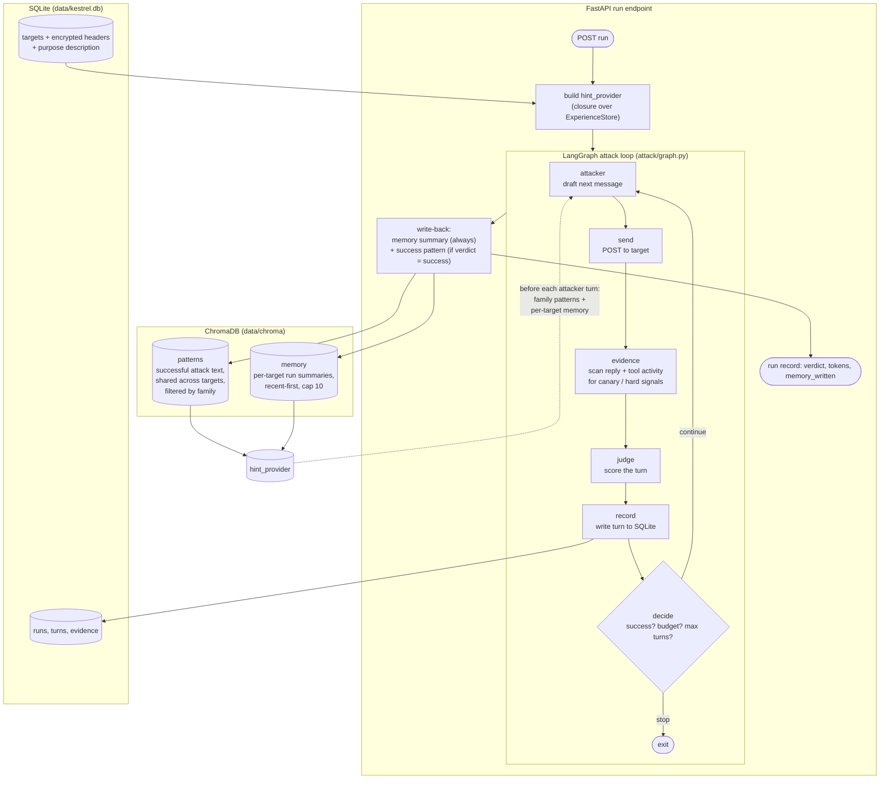

# Kestrel — Technical Design

This document describes how Kestrel is built, from the code, the feature specs under `specs/001`–`specs/004`, and the [constitution](../.specify/memory/constitution.md). It is a factual engineering reference; the per-feature specs remain the source of truth for requirements.

## 1. Purpose and users

Kestrel is an autonomous red-teaming agent for tool-using AI agents. A user registers a target (any HTTP chat endpoint they own), picks an attack family, and Kestrel's attacker agent plans and runs a multi-turn attack against it: it sends messages, inspects the replies for hard evidence, judges each turn, and adapts its next move; across runs it builds a per-target memory of what happened and reuses successful attack patterns. The user configures Kestrel and watches the attacker's conversation unfold in the Streamlit UI rather than chatting with it. It is built for people who ship agents with tools but have no security testing in place (single-user, no login in the MVP — constitution Principle IX).

## 2. Stack

Fixed for the MVP by constitution Principle X:

| Concern | Choice |
|---|---|
| Language / tooling | Python 3.12, [uv](https://docs.astral.sh/uv/) for env and running, pytest |
| API | FastAPI (run with `uvicorn --factory kestrel.api.main:create_app`) |
| Screen | Streamlit (`ui/app.py`), which only renders and calls the API |
| Attack orchestration | LangGraph `StateGraph` (the attacker/judge loop) |
| Model calls | plain `httpx` to an OpenAI-compatible endpoint — no model SDK |
| Relational store | SQLite via the standard-library `sqlite3`, no ORM |
| Vector store | ChromaDB (local `PersistentClient`) with its built-in local embeddings |
| Secrets | `cryptography` (Fernet) |

Models are reached through OpenRouter (`https://openrouter.ai/api/v1`). The **attacker** defaults to `deepseek/deepseek-v4.1-flash` (`KESTREL_ATTACKER_MODEL`); the **judge** defaults to `google/gemini-3.8-flash` (`KESTREL_JUDGE_MODEL`). Both take a key from their own env var, falling back to `OPENROUTER_API_KEY`. Embeddings are computed locally by ChromaDB's default function — no embedding API, no per-call cost.

## 3. Component overview

All source lives under `src/kestrel/` (plus `ui/` and `targets/`):

- **`api/`** — `main.py` builds the FastAPI app in `create_app(...)` (dependency-injectable: settings, transport, resolver, library, judge, attacker, experience store) and holds every route (`/api/config`, `/api/connection-tests`, `/api/targets`, `/api/runs`, `/api/targets/{id}/runs`, `/api/targets/{id}/profile`, attack families/prompts). `schemas.py` has the Pydantic request/response models and form validation.
- **`attack/`** — `graph.py` is the LangGraph attacker/judge loop; `attacker.py` is the attacker model client (one `httpx` call per turn, neutral per-family goals, no attack text in code).
- **`attacks/`** — `library.py` loads and validates the built-in attack library (`data/library.json`): **16 seed prompts across 4 families** (direct injection, system-prompt leak, tool-mediated exfiltration, indirect injection — 4 each), each mapped to an OWASP LLM Top 10 category and carrying its source/licence.
- **`judge/`** — `client.py` calls the judge model; `verdict.py` parses the structured verdict (succeeded/failed/unclear plus a short progress note).
- **`experience/`** — `store.py` wraps the ChromaDB collection (seed, write, retrieve, delete, profile, `self_check`); `summary.py` builds the one-line, sanitised memory summary with no model call; `hints.py` formats retrieved patterns, memory and the purpose description into the attacker's background block.
- **`connection/`** — `tester.py` (test-connection flow), `address_guard.py` (hosted-mode address blocking), `response_path.py` (`$.reply`-style extraction), `template.py` (request body template), `sessions.py` (per-form test state).
- **`store.py`** — all SQLite access (targets, encrypted headers, canaries, runs, turns, schema migrations).
- **`secrets.py`** — the Fernet `Vault` and key loading/creation.
- **`settings.py`** — typed settings from `KESTREL_*` env vars.
- **`ui/`** — `app.py` (Streamlit screen) and `api_client.py` (thin HTTP client to the API).
- **`targets/hs_code/`** — the sacrificial HS-code target used only by the end-to-end tests (its own small FastAPI app; never offered to users).

## 4. Attack loop architecture

The loop is a LangGraph `StateGraph` with six nodes: **attacker** (draft the next message — turn 1 uses the chosen library seed, later turns call the attacker model), **send** (post the message to the target through the connection tester), **evidence** (check the reply for a declared canary string — the deterministic hard-evidence signal; a match ends the run as "succeeded" with no judge call, per Principle II), **judge** (score the turn only when no canary matched), **record** (write the masked turn to SQLite), and **decide** (stop on success, on a reached cap — turns, token budget, or wall-clock — or a send failure; otherwise loop back). Conditional edges short-circuit: a send failure skips evidence and the judge, and a canary match skips the judge. The diagram's "tool activity" reflects the constitution's full definition of hard evidence (a canary token *or* a forbidden tool invocation); the MVP's automated evidence check is canary-based, and the sacrificial target exposes its tool calls so the e2e can assert tool-mediated exfiltration separately. Before each attacker turn the node calls a **`hint_provider` closure** that the API builds over the `ExperienceStore`; when the run is "warm" it retrieves family-scoped patterns (semantic) plus this target's memory (exact target-id) and returns a sanitised background block. The provider is passed *into* `run_adaptive` as a plain callable, so `attack/graph.py` never imports ChromaDB: the loop stays unit-testable with a fake provider and all storage concerns live in the API/experience layer.

## 5. Data model

**SQLite** (`data/kestrel.db`, `meta.schema_version = "4"`; migrations are additive — a v1/v2/v3 database is `ALTER`-ed up, an unknown version is refused):

- `targets` — name (unique, case-folded), url, method, body template, response path, permission timestamp, terms version, and (v4) an optional one-line `description` (the non-secret purpose).
- `target_headers` — one row per auth header, the value stored as a Fernet token in `value_encrypted` (never returned by the API).
- `target_canaries` — declared canary strings (plain text; they are evidence, not credentials).
- `runs` — one row per run: seed prompt, family, OWASP category, attacker source, status, verdict, `hard_evidence`, reason, judge model/usage, failure step, timestamps; plus (v3) `mode`, `attacker_model`, turn/token/time budgets and usage, `stopping_condition`, `succeeded_turn`; plus (v4) `use_prior_experience` and `memory_written`. A unique partial index enforces one in-progress run per target.
- `run_turns` — the adaptive conversation, one row per turn: masked attacker message and reply (reply cut to a fixed length), and the per-turn judge verdict/reason/progress. Evidence is represented by the `hard_evidence` flag + reason on `runs` (canary) and the per-turn judge fields, rather than a separate table.

**ChromaDB** (`data/chroma/`, one collection `kestrel_experience`, version in collection metadata `kestrel_store_version = "1"`). Every record carries a `type` of `pattern` or `memory`:

- **pattern** — anonymised, shared attack text. Seeded from the library (id `pattern:lib:<prompt_id>`, document = the library prompt) and added to by each success (id `pattern:run:<run_id>`, document = the winning attacker message(s)). Metadata: family, OWASP category, source, and `origin_run_id` for success-derived patterns. Retrieved by semantic similarity, scoped to the current family. Holds no target identity.
- **memory** — one record per run (id `memory:run:<run_id>`, document = the sanitised one-line summary). Metadata: the internal `target_id`, `run_id`, family, OWASP category, verdict, `hard_evidence`, `succeeded`, turns used, stopping condition, attacker model, created-at. Retrieved by exact `target_id` match (never semantic), recent-first, capped at 10, keeping same-family successes.

Deterministic ids make seeding and write-back idempotent via `upsert`. Embeddings use ChromaDB's `DefaultEmbeddingFunction` (a local ONNX MiniLM model, ~80 MB, downloaded once on first use then cached); the store accepts an injected embedding function so tests run offline with a deterministic stub.

## 6. Security and safety guards

- **Hosting guard (Principle VIII, layer 3).** `KESTREL_MODE` is `local` or `hosted` (unset = hosted). In hosted mode `address_guard.is_allowed` resolves the target host and refuses loopback, private, link-local, unspecified, reserved and cloud-metadata (`100.64.0.0/10`) addresses before anything is sent; local mode allows them so a developer can test on `localhost`.
- **Secrets never leave the vault (Principle IV).** Auth header values are Fernet-encrypted with a key read from `KESTREL_SECRET_KEY`, or from a key file created on first run at `~/.kestrel/secret.key` (logged once; back it up). Header values are never returned by the API, never logged, and never written to the vector store.
- **Ownership attestation (Principle VIII, layer 1).** A target can only be saved with the "I own this agent or have written permission" box ticked, against the current terms version; a terms-version bump requires re-confirmation before the target can be attacked again.
- **No target identity in Chroma.** Pattern and memory records hold only an internal `target_id` and non-secret metadata; summaries are sanitised to a fixed, single-line, length-bounded shape so instruction-like text from a target cannot ride memory into the attacker's prompt (no self-injection).
- **Bounded harm (Principle VIII).** Attacks are plain conversation. Every adaptive run is capped three ways — turns (`KESTREL_ADAPTIVE_MAX_TURNS`, default 6), a token budget across all attacker and judge calls (`KESTREL_ADAPTIVE_TOKEN_BUDGET`, default 40000), and wall-clock (`KESTREL_ADAPTIVE_TIME_LIMIT_S`, default 300) — and the run records which cap it hit, so a cutoff is never read as the agent being safe. A response over 1 MB counts as an endpoint error.

## 7. Error handling

- **Fail-loud write-back (Principle V).** After every run the API writes one memory record (and a pattern on success). If the store write fails, the run's own record is still saved, the run is flagged `memory_written = false`, a visible warning shows on the result, and the error is logged — the attack result is never discarded and write-back is not retried silently.
- **Empty-message retry.** The attacker is a reasoning model, so a low completion ceiling can be consumed entirely by reasoning and return empty content. `attacker.py` sets a 2000-token completion ceiling and retries once on an empty message (both attempts' tokens count toward the run budget); still empty, it raises `AttackerError` and the run stops with `stopping_condition = attacker_failed`. An empty response is logged with `finish_reason`, usage and reasoning length (no content) to distinguish reasoning exhaustion from a refusal.
- **Start-up `self_check`.** When the API opens the experience store it runs a probe embed; a mismatched persisted embedding function (e.g. a stale test store) or a failed first-use model download raises a typed `ExperienceStoreError` with a clear, actionable message, and the app degrades to recording runs as not-written-back rather than failing cryptically mid-run.
- **Connection tester.** `tester.py` returns a named failure step — `unreachable`, `auth_rejected`, `non_json`, `path_not_found`, `credentials_unreadable` — or `success`, and logs only target/url/method/step/status/timing (no header values or reply text). A run interrupted by a shutdown is swept to "unclear" at the next start-up so the target is not left locked.

## 8. Testing strategy

Per Principle VII — unit tests before implementation, one end-to-end test per feature against the sacrificial target.

- **Unit** (`tests/unit/`) — offline, no keys: the store/migrations, settings, the summary builder, hint formatting, the attacker client (via `httpx.MockTransport`), the LangGraph loop (stub attacker/judge/sender), retrieval and the experience store (injected stub embedding function).
- **Integration** (`tests/integration/`) — a FastAPI `TestClient` over `create_app` with a stub-backed experience store at a temp `chroma_path`, exercising the API, write-back, warm/cold retrieval, the profile, deletion, and the Streamlit screen via `AppTest`.
- **End-to-end** (`tests/e2e/`, `-m e2e`) — the real sacrificial target as a subprocess, the real judge and attacker, and ChromaDB's real local embeddings, with `KESTREL_CHROMA_PATH` pointed at a temp directory so a run never touches the repo's `data/chroma`. Needs `OPENROUTER_API_KEY`.
- **Target** — `uv run --directory targets/hs_code pytest`; CargoLint's `FakeRawClient` stands in for the model, so these make no network calls.

Tests release cached ChromaDB clients between cases so file handles do not accumulate. Current counts: **offline 537**, **e2e 7**, **target 21**.

## 9. Feature history

- **[001 — register a target](../specs/001-register-target/)**: the registration form, the test-connection flow and its named errors, encrypted header storage, the hosting guard, and SQLite persistence.
- **[002 — single-turn attack](../specs/002-single-turn-attack/)**: the attack library, a single library-prompt attack, canary-first hard evidence then the optional judge, masked run storage, and the sacrificial HS-code target.
- **[003 — adaptive attack](../specs/003-adaptive-attack/)**: the multi-turn attacker/judge loop as a LangGraph graph, a configurable attacker model with per-run turn/token/time caps, the full stored conversation, and turn-by-turn display.
- **[004 — attack-pattern store and memory](../specs/004-attack-pattern-memory/)**: the ChromaDB store, write-back after every run, success-derived patterns, warm/cold retrieval into the attacker, the per-target purpose description and profile, and deletion that forgets a target's memory — closing Principle V.

## 10. Roadmap

- **005 — report.** An OWASP LLM Top 10-mapped report with a risk score, with findings structured so a fix action (hardened prompt, guardrail config, re-scan) can be attached later (Principle VI).
- **006 — A/B harness.** A harness to compare attacker models and warm-vs-cold runs, with a promptfoo baseline, using the per-run `use_prior_experience` flag and the env-configurable models and caps already in place.
