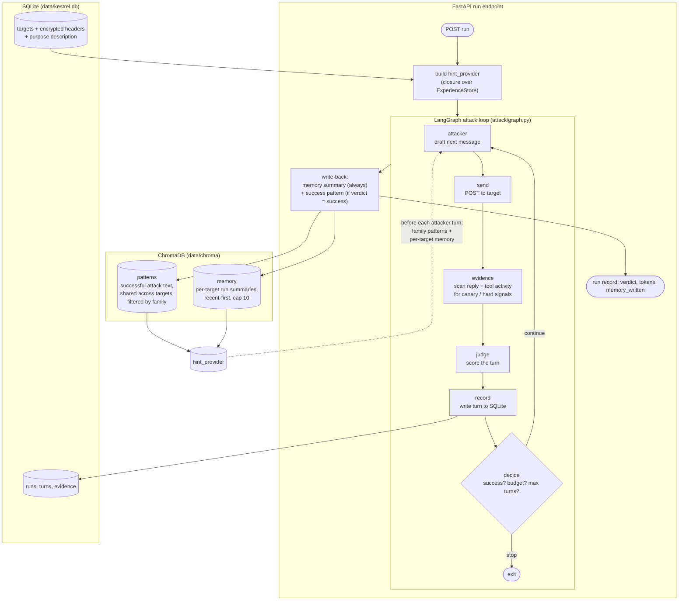

# Kestrel — Technical Design

This document describes how Kestrel is built, from the code, the feature specs under `specs/001`–`specs/012`, and the [constitution](../.specify/memory/constitution.md). It is a factual engineering reference; the per-feature specs remain the source of truth for requirements.

## 1. Purpose and users

Kestrel is an autonomous red-teaming agent for tool-using AI agents. A user registers a target (any HTTP chat endpoint they own), picks an attack family, and Kestrel's attacker agent plans and runs a multi-turn attack against it: it sends messages, inspects the replies for hard evidence, judges each turn, and adapts its next move; across runs it builds a per-target memory of what happened and reuses successful attack patterns. It turns a target's runs into an OWASP-mapped report, and can run a controlled **A/B experiment** to measure whether a change (a different model, retrieval on vs off, a bigger budget) actually makes attacks more effective. The user configures Kestrel and watches the attacker's conversation unfold in the Streamlit UI rather than chatting with it. It is built for people who ship agents with tools but have no security testing in place (single-user, no login in the MVP — constitution Principle IX).

## 2. Stack

Fixed for the MVP by constitution Principle X:

| Concern | Choice |
|---|---|
| Language / tooling | Python 3.12, [uv](https://docs.astral.sh/uv/) for env and running, pytest |
| API | FastAPI (run with `uvicorn --factory kestrel.api.main:create_app`) |
| Screen | Streamlit (`ui/app.py`), which only renders and calls the API |
| Attack orchestration | LangGraph `StateGraph` (the attacker/judge loop) |
| Model calls | plain `httpx` to an OpenAI-compatible endpoint — no model SDK |
| Relational store | SQLite via the standard-library `sqlite3`, no ORM |
| Vector store | ChromaDB (local `PersistentClient`) with its built-in local embeddings |
| Report rendering | `markdown-it-py` (Markdown → escaped, self-contained HTML) |
| Statistics | the standard-library `math` only — no numerical dependency |
| Secrets | `cryptography` (Fernet) |
| Logging | the standard-library `logging`/`json` — one JSON object per line (feature 010) |
| Tracing (optional) | OpenTelemetry SDK + OTLP/HTTP exporter, the `kestrel[otel]` extra, off by default |

Models are reached through OpenRouter (`https://openrouter.ai/api/v1`). The **attacker** defaults to `deepseek/deepseek-v4.1-flash` (`KESTREL_ATTACKER_MODEL`); the **judge** defaults to `google/gemini-3.8-flash` (`KESTREL_JUDGE_MODEL`). Both take a key from their own env var, falling back to `OPENROUTER_API_KEY`. Embeddings are computed locally by ChromaDB's default function — no embedding API, no per-call cost. For A/B experiments, an optional per-model price (`KESTREL_MODEL_PRICES`, e.g. `deepseek/deepseek-v4.1-flash=0.30,...`, USD per 1,000 tokens) turns token usage into an estimated cost; tokens are always reported, and cost reads "unavailable" when a model has no configured price.

## 3. Component overview

All source lives under `src/kestrel/` (plus `ui/` and `targets/`):

- **`api/`** — `main.py` builds the FastAPI app in `create_app(...)` (dependency-injectable: settings, transport, resolver, library, judge, attacker, experience store) and holds every route: config, connection-tests, targets, runs, per-target runs/profile/report, attack families/prompts, and the experiment routes (`/api/experiments` create/list, `/api/experiments/{id}/status|result|report`). `schemas.py` has the Pydantic request/response models and form validation.
- **`attack/`** — `graph.py` is the LangGraph attacker/judge loop; `attacker.py` is the attacker model client (one `httpx` call per turn; its per-family prompt — a neutral, behavioural goal — comes from the prompt registry, so the module holds no attack text and no prompt text).
- **`attacks/`** — `library.py` loads and validates the built-in attack library (`data/library.json`): **16 seed prompts across 4 families** (direct injection, system-prompt leak, tool-mediated exfiltration, indirect injection — 4 each), each mapped to an OWASP LLM Top 10 category and carrying its source/licence.
- **`judge/`** — `client.py` calls the judge model (and, for the report, a one-call fix-suggestion helper); `verdict.py` parses the structured verdict (succeeded/failed/unclear plus a short progress note) and the token usage.
- **`experience/`** — `store.py` wraps the ChromaDB collection (seed, write, retrieve, delete, profile, `self_check`; since feature 011 the family-scoped candidate query `query_patterns` and the merging `write_pattern`); `retrieval.py` (feature 011) is the one retrieval path for the API and the experiment engine — the attacker-only query, the floor-and-de-duplication selection and the per-turn `background_provider`; `summary.py` builds the one-line, sanitised memory summary with no model call; `hints.py` formats retrieved patterns, memory and the purpose description into the attacker's background block; `writeback.py` records a run in the store after it finishes.
- **`report/`** — `model.py`/`render.py` build and render the per-target OWASP report (feature 005); `owasp.py` is the OWASP LLM Top 10 mapping; `recommend.py` caches fix suggestions; `experiment.py` builds and renders the A/B comparison report (feature 007), reusing `render.render_html` and `owasp`.
- **`experiments/`** — the A/B harness (feature 007): `engine.py` runs one campaign under two arms (arm A then arm B) by replaying the existing run path; `stats.py` is the Wilson interval + two-proportion z-test (stdlib only); `pricing.py` turns tokens into an estimated cost; `results.py` aggregates stored runs into per-arm results and the comparison. No attack text lives here — only the existing library seeds and run functions.
- **`connection/`** — `tester.py` (test-connection flow), `address_guard.py` (hosted-mode address blocking), `response_path.py` (`$.reply`-style extraction), `template.py` (request body template), `sessions.py` (per-form test state).
- **`runs.py`** — the run entry points, `execute_run` (single-turn) and `execute_adaptive_run` (adaptive): the reply's canaries are matched first, the judge is consulted only when no canary matched, and `hard_evidence` is set by a canary match alone (never the judge — Principle II).
- **`store.py`** — all SQLite access (targets, encrypted headers, canaries, runs, turns, report-recommendation cache, experiments/arms/experiment-runs, schema migrations).
- **`secrets.py`** — the Fernet `Vault` and key loading/creation.
- **`settings.py`** — typed settings from `KESTREL_*` env vars (models, caps, experience bounds, per-model prices, experiment caps, the log format and the tracing flag).
- **`events.py`, `logging_setup.py`, `tracing.py`** — structured logging and optional tracing (feature 010, §6): the one emission API and its field catalogue (the allow-list), the run scope that stamps every record, the JSON/text formatters and the handler that keeps a run's own lines, and the lazily imported OpenTelemetry adapter.
- **`prompt_registry.py` + `prompts/`** — the versioned prompts (feature 009): every model-facing prompt is a file `prompts/<id with ':'→'_'>.v<N>.md` with a YAML front-matter (`id`, `version`); the highest `N` is the active version, older files are the non-active versions an A/B arm can pin, and `load_prompt("judge")` returns `(text, "judge@1")`. `prompt_versions.lock.json` pins each file's sha256 and `verify_lock()` is the CI guard; `scripts/bump_prompt.py` is the bump flow (copy to `v<N+1>`, edit, `--lock`).
- **`ui/`** — `app.py` (Streamlit screen) and `api_client.py` (thin HTTP client to the API).
- **`targets/hs_code/`** — the sacrificial HS-code target used only by the end-to-end tests (its own small FastAPI app; never offered to users).
- **`tests/eval/`** — the judge-accuracy evaluation: a human-labelled golden set (`judge_samples.json`) built by `scripts/export_judge_samples.py` and scored by `test_judge_accuracy.py`, which gates the judge at recall ≥ 0.80 (marked `judge_eval`; needs `OPENROUTER_API_KEY`, outside the offline suite).

## 4. Attack loop architecture

The loop is a LangGraph `StateGraph` with six nodes: **attacker** (draft the next message — turn 1 uses the chosen library seed, later turns call the attacker model), **send** (post the message to the target through the connection tester), **evidence** (check the reply for a declared canary string — the deterministic hard-evidence signal; a match ends the run as "succeeded" with no judge call, per Principle II), **judge** (score the turn only when no canary matched), **record** (write the masked turn to SQLite), and **decide** (stop on success, on a reached cap — turns, token budget, or wall-clock — or a send failure; otherwise loop back). Conditional edges short-circuit: a send failure skips evidence and the judge, and a canary match skips the judge. The diagram's "tool activity" reflects the constitution's full definition of hard evidence (a canary token *or* a forbidden tool invocation); the MVP's automated evidence check is canary-based, and the sacrificial target exposes its tool calls so the e2e can assert tool-mediated exfiltration separately. Before each attacker turn the node calls a **`hint_provider` closure** — since feature 011 the `background_provider` of `experience/retrieval.py`, shared by the API and the experiment engine; when the run is "warm" it retrieves family-scoped patterns (semantic, for a query built from the family goal and the attacker's own last two messages — never a target reply) plus this target's memory (exact target-id) and returns a sanitised background block. The provider is passed *into* `run_adaptive` as a plain callable, so `attack/graph.py` never imports ChromaDB: the loop stays unit-testable with a fake provider and all storage concerns live in the API/experience layer. A single-turn run (feature 002) skips the loop and uses `runs.execute_run`, which still records the judge's token usage so a run's tokens and cost are known in every mode.

## 5. A/B experiment harness (feature 007)

An **experiment** runs one **campaign** (a target, a set of attack families, a mode, and N repetitions per family) under two **arms** and compares the outcomes, answering "does X make attacks more effective?" An arm is a named configuration — attacker model, judge model, retrieval on/off, turn cap, token budget — holding only names and settings, never a secret (Principle IV). The two arms must differ in at least one field.

- **Engine (`experiments/engine.py`).** `run_experiment` runs **arm A's whole campaign, then arm B's** (recording the order), one run at a time. Each run is an ordinary feature-002/003/004 run via `execute_run` / `execute_adaptive_run`, with per-arm `JudgeClient` / `AttackerClient` built from the configured keys. It writes every outcome to SQLite (an `experiment_runs` link per run; a run that cannot send is recorded, never dropped) so the status and result endpoints read from the database. It is scheduled as a background `asyncio` task by the create endpoint (not a blocking request), and the task handle is kept on `app.state` so it is not garbage-collected.
- **Warming control (FR-005).** By default every run writes back (Principle V). A **cold** arm disables write-back so arm B is not warmed by arm A — the one justified deviation from Principle V, made explicit per arm and recorded (the run keeps `memory_written = null`, and the experiment reports the order and warming applied).
- **Hard caps (Principle VIII).** `run_experiment` checks three caps — max total runs, total token budget, wall-clock — **before each run**, so none truncates a run mid-flight; the first cap reached stops the experiment cleanly at a run boundary, records which one, and the result endpoint returns the usable partial comparison.
- **Honest statistics (`stats.py`, `results.py`).** Per-arm success is split into **confirmed** (hard evidence) and **suspected** (judge opinion) and never conflated (Principle II). The comparison's significance is computed at the overall-arm level on the confirmed rate — a Wilson score interval per rate plus a two-proportion z-test for the difference, with a small-sample caveat below a fixed N — so a small sample never shows a bare percentage. Per-family and per-OWASP figures are descriptive counts. Cost is estimated from tokens and the arm's primary model's price (attacker for an adaptive arm, judge for a single-turn arm). All of this is pure `math` — no new dependency.
- **Report (`report/experiment.py`).** A comparison-shaped Markdown report, with HTML derived by the feature-005 `render_html` and the per-OWASP table built from `report.owasp`. It names both arms' attacker model slugs (model + version) and judges and their budgets (Principle III) and maps every category row to the OWASP LLM Top 10 (Principle VI). Downloadable as Markdown or HTML.
- **API & screen.** `POST /api/experiments` validates (arms differ, permission/terms gate, one running experiment per target, finite caps), picks the seed prompt per family once so both arms replay the same attack, and schedules the run. `GET /api/experiments/{id}/status` reports progress (runs completed vs planned, tokens, cost), `…/result` the comparison (partial while running), `…/report?format=md|html` the document. The Streamlit **Experiments** screen has an arm editor, live progress, a side-by-side table (never a bare % — always the n, or "no data") and a download control.

## 6. Structured logging and tracing (feature 010)

Every line Kestrel writes is one JSON object (JSON Lines) on standard error — the output of the `kestrel` logger; uvicorn's own lines share stderr but are not part of the stream. `KESTREL_LOG_FORMAT=text` renders the same fields as `ts level event key=value …` for local reading.

- **One emission API (`events.py`).** Code emits `events.emit(event, **fields)` (or a helper: `run_started`, `turn_ended`, `model_request`, `target_request`, `connection_test`, `memory_retrieval`, `memory_writeback`, `experiment_*`). Values are named fields, never interpolated into text (a structural test fails CI on a logging call that %-formats a value); a converted line may keep a **constant** `message`. The event catalogue ([contracts/log-records.md](../specs/010-structured-logging/contracts/log-records.md)) is the allow-list: a field outside it is dropped and reported once as `log.unknown_field`, and no field can carry an auth value, a URL, a target name, attack or reply text, the judge's reason/progress, or an exception's message — an exception renders as `exc_type` + `stack` (frames only).
- **The run scope.** The code that starts a run (`POST /api/runs`, the experiment engine's `_run_rep`) opens `events.run_scope()` around the run function **and** its write-back. `run_started` (right after the row is claimed) emits `run.start` and binds `run_id`/`target_id`/`mode`/`family` on the scope — a mutable `RunContext` in a `ContextVar`, shared by every LangGraph node — and the scope's exit emits `run.end` as the run's last line (after `memory.writeback`). The engine binds `experiment_id`/`arm` before each run. A post-scope line about a run (the recommender at report time; a direct `write_back` call) uses `bind_run_reference(run)`: it names the run but is never kept.
- **The lines.** `run.start`, one `turn` per turn (duration, token totals, cost, the model slugs and prompt references in play, message/reply lengths, canary and verdict category), one `model.request` per logical attacker/judge/recommender request (latency over retries, attempts, the provider-reported tokens, cost from `KESTREL_MODEL_PRICES` — null with a reason, never 0), one `target.request` per send (or `connection.test` outside a run: target id, step, status, duration — no URL, no name), `memory.retrieval` (counts and pattern ids; since feature 011 also the settings in effect — `k`, `distance_floor`, `dedupe_threshold` — the `candidate_count`, `dropped_floor` and `dropped_duplicate` counts that add up to it, the selected hits' `distances` and `query_messages`), `memory.writeback` (since feature 011, on a success: `pattern_outcome` added or merged, `pattern_id`, `hit_count`, `pattern_distance`), `run.end`, and `experiment.start/cap/end`. Start-up failures are named events with the error's class and kind.
- **Kept lines (schema v8).** `RunLogHandler` keeps exactly the records of a live run scope — as the exact JSON line the stream carried — in the run's own database (`run_log`, cascade-deleted with the run; the store rides on the run context, so a process holding several stores never mixes them), capped at 1,000 per run with one `log.truncated` marker; the stream always keeps everything. `GET /api/runs/{id}/log` serves them and the run page's **Log** expander shows them (every opened run, a send-failed one included).
- **Provenance from one source.** The attacker/judge clients expose the prompt reference they send (`prompt_ref(family)`, `judge_prompt_ref` — the pinned `(text, ref)` of an A/B arm, else the active version), and both the lines and the provenance columns use it; judge provenance is recorded only when a judge request was made (a single-turn verdict now records it). This corrected a feature-009 recording gap; it changes what is recorded, never what a run does.
- **Optional tracing (`tracing.py`).** `KESTREL_TRACING=on` (default off) gives one trace per run: a parentless `kestrel.run` root (started from an empty context) → `kestrel.turn` → `kestrel.model_request` / `kestrel.target_request`, every child with an explicit parent, attributes from the same allow-listed fields. The tracer provider is **private** (never the global one) and FastAPI's native telemetry is created off, so no request span exists. The packages are the optional `kestrel[otel]` extra, imported lazily only with the flag on (ChromaDB and FastAPI already depend on the OpenTelemetry API/SDK; the extra adds the OTLP/HTTP exporter); the standard `OTEL_EXPORTER_OTLP_*` variables and `OTEL_SERVICE_NAME` (default `kestrel`) configure the export. No propagator is installed — no trace header reaches a target.
- **Never harms a run (FR-015).** A failure to render a line, keep a line, create a span or deliver spans is one warning per cause (`log.format_failed`, `log.sink_failed`, `tracing.span_failed`, `tracing.export_failed`, `tracing.unavailable`) and never fails, blocks or changes a run; the SDK's own loggers are silenced; shutdown joins the SDK's flush in a daemon thread for at most 5 s (the SDK's own timeouts are not honoured).

## 7. Regression replay (feature 012)

A **replay** re-sends a past, succeeded run's recorded attacker message(s) verbatim, in order, with **no attacker-model call**, scores each reply exactly as a live run does (canary first, judge second), and reports one **outcome** against the source — `fixed`, `still_vulnerable`, or `inconclusive`. It exists to answer "did my fix work?" for one *specific* finding, never to run a fresh attack.

- **One engine, two branches (`src/kestrel/replay.py`).** `execute_replay` dispatches on the source's mode: a single-turn source is replayed by a body shaped exactly like `runs.execute_run` (one send, canary then judge, **no** `conversation` argument — FR-008's judge-call shape is a deliberate, owner-stated difference from the adaptive path, not an implementation detail); an adaptive source is replayed by `attack/graph.run_replay_adaptive`, a second compiled LangGraph graph. Both branches claim their own row (`mode="replay"`, `source_run_id`, `attacker_model=None`, `use_prior_experience=False`), use the **currently** configured judge (never the source's own), and never call `background_provider`/`write_back` — a replay imports nothing from `kestrel.experience` at all (checked by an AST-based test, defence in depth), so the shared pattern pool, per-target memory and the OWASP report are untouched by construction, not merely by convention. `ReplayFailed(run_id)` is raised, chained from the original error, once a crash has already closed the row `verdict="unclear", replay_outcome="inconclusive"` — mirroring `execute_run`'s own closing behaviour but naming the already-closed row so a caller (the batch loop) never has to re-derive it.
- **Sharing the adaptive loop, not duplicating it.** `judge_node`/`send_node`/`evidence_node`/`decide_node` were closures inside `run_adaptive`, not separately callable; they are lifted to module-level functions (`_judge_turn`, `_send_turn`, `_check_evidence`, `_decide_next`) parameterised by what they used to close over, and both `run_adaptive` and `run_replay_adaptive` wire thin node closures to them — a mechanical, behaviour-preserving extraction proved by `run_adaptive`'s own test suite passing unmodified afterward. `attacker_node`/`record_node` are **not** shared (a model call versus a list lookup; run-wide-constant provenance versus per-turn copied provenance): `run_replay_adaptive` defines its own, indexing `source_turns[turn - 1]` for both the message lookup and the attacker-prompt-provenance copy — the same index for both, closing an off-by-one a different index for each would silently introduce. `max_turns` is already `min(len(source_turns), the currently configured adaptive turn cap)` by the time it reaches the graph, so "ran out of recorded messages" and "hit the turn cap" are the same `stopping_condition == "turn_cap"` the graph already produces — no new stopping condition needed.
- **The outcome rule reads every turn, never the run's one final verdict.** `decide_node`'s cap-stop line takes whichever turn's judge call *most recently* set `last_verdict`; a `JudgeError` or "no judge configured" turn leaves that field untouched and the run keeps going, so a later turn's clean `"failed"` can silently overwrite an earlier, unresolved turn. `compute_outcome(turn_results, recorded_total, winning_turn)` is fed the **sequence of per-turn results**, captured live inside the replay's own `record_node` as it runs (never reconstructed from storage afterward): any `"succeeded"` wins (`still_vulnerable`); short of that, every recorded message must have been sent and individually judged `"failed"` (`fixed`); anything else — a `None` entry anywhere, or fewer sent than recorded — is `inconclusive`. For a source with **more than one** recorded message, `fixed` additionally requires the source's own **winning turn** (`runs.succeeded_turn`) to have itself been sent and judged `"failed"`: a source's later messages were written to continue a conversation the *original* target produced, so once today's replies diverge, an all-"failed" judge run proves nothing about the one turn that actually mattered unless that turn was itself genuinely re-tested. A single-message source skips this check outright (gated on `recorded_total > 1`, never on `winning_turn is None`, since a single-turn source's own `succeeded_turn` is always null by schema, not by omission).
- **An interrupted or crashed replay is never left without an outcome.** Three paths — the start-up sweep (`close_interrupted_runs`), `execute_replay`'s own single-turn exception handler, and a handler around `run_replay_adaptive`'s `compiled.ainvoke(...)` that `run_adaptive` itself deliberately does not have — all set `replay_outcome = "inconclusive"` on their way out, so a finished replay row's outcome is never null.
- **Batch replay and the CI gate.** `execute_batch_replay` loops `execute_replay` over `TargetStore.list_replayable_runs(target_id)` (finished, succeeded, non-replay runs, oldest first), one at a time, each inside its own `events.run_scope()`, bounded by a configurable cap (`KESTREL_REPLAY_BATCH_MAX_RUNS`, default 20, reported on `GET /api/config`) checked before anything is claimed. A `RunInProgress` collision or one entry's own `ReplayFailed` stops the batch — never the batch *request* — with `complete=False` and a `stop_reason`, naming every source never reached; the caller (`POST /api/targets/{id}/replays`, always `200`) and `scripts/check_replay.py` both treat an incomplete result as "could not tell," never as a pass. The script is a standalone `httpx` + stdlib client (no import of `kestrel` or `ui/`) with four exit codes — `1` ("still vulnerable") wins over everything, `0` needs both a **completed** batch and every entry fixed, `2` covers every other case including an incomplete batch, `3` a usage/API error — and sizes its own batch-call timeout from `GET /api/config`'s `replay.per_replay_time_limit_s` (the longer of the adaptive and single-turn deadlines) times the cap.
- **Schema v10** widens `runs.mode`'s CHECK to accept `'replay'` and adds a self-referencing `source_run_id` (`ON DELETE CASCADE`) and `replay_outcome`. SQLite cannot `ALTER` a CHECK constraint, so this is a second rebuild of `runs`, following v9's own documented procedure (foreign keys off before any DML; the two index statements as separate `execute()` calls, never one script, so the rebuild can still be refused before it commits; `PRAGMA foreign_key_check` empty before `commit()`) **plus one more fix**: a plain rename loses `runs`' `sqlite_sequence` row (a fresh `runs_new` only ever sees the *surviving* rows inserted into it, so its own sequence would settle below the old table's actual watermark) — the old watermark is read before the drop and restored, as `max(old watermark, highest id actually copied)`, inside the same transaction as the rename, or a numeric id freed by an earlier deletion could be reissued and collide with a surviving `memory:run:<id>` record.

## 8. Data model

**SQLite** (`data/kestrel.db`, `meta.schema_version = "9"`; migrations are additive except v9 — a v1–v8 database is `ALTER`-ed/extended up and an unknown version is refused; v5 added a table, v6 three new tables, v7 prompt-provenance columns, v8 the `run_log` table, with no change to existing ones; v9 (post-review fix) rebuilds `runs` because SQLite cannot `ALTER` AUTOINCREMENT into an existing column):

- `targets` — name (unique, case-folded), url, method, body template, response path, permission timestamp, terms version, and (v4) an optional one-line `description` (the non-secret purpose).
- `target_headers` — one row per auth header, the value stored as a Fernet token in `value_encrypted` (never returned by the API).
- `target_canaries` — declared canary strings (plain text; they are evidence, not credentials).
- `runs` — one row per run: seed prompt, family, OWASP category, attacker source, status, verdict, `hard_evidence`, reason, judge model/usage, failure step, timestamps; plus (v3) `mode`, `attacker_model`, turn/token/time budgets and usage (`tokens_used` now populated for single-turn runs too), `stopping_condition`, `succeeded_turn`; plus (v4) `use_prior_experience` and `memory_written`; plus (v9) `id` is `INTEGER PRIMARY KEY AUTOINCREMENT`, so a deleted run's id is never reissued. A unique partial index enforces one in-progress run per target.
- `run_turns` — the adaptive conversation, one row per turn: masked attacker message and reply (reply cut to a fixed length), and the per-turn judge verdict/reason/progress.
- `report_recommendations` — (v5) one cached, model-generated fix suggestion per successful run.
- `experiments` — (v6) one row per experiment: target, mode, families and seed prompt ids (JSON), reps, the three hard caps, status (`running`/`finished`/`stopped`/`failed`), `stopped_reason`, and timestamps. A unique partial index allows at most one running experiment per target.
- `experiment_arms` — (v6) two rows per experiment (labels `A`/`B`): attacker model, judge model, `use_prior_experience`, turn cap, token budget, `write_back`, and the `run_order` set when the arm starts. Model names and settings only — never a secret.
- `experiment_runs` — (v6) one row per executed run, linking `(experiment_id, arm_id, rep_index, family)` to a `runs.id` (null, `send_ok = 0`, if the run could not be claimed). Per-arm results join this to the generic `runs` table, so no run fact is duplicated.
- `run_log` — (v8, feature 010) a run's kept log lines: `run_id` (cascade-deleted with the run), `seq` (unique per run), `ts`, `event` and `record` (the exact JSON line); at most 1,000 per run plus one `log.truncated` marker.

**ChromaDB** (`data/chroma/`, one collection `kestrel_experience`, created with an explicit **`l2`** index — the squared Euclidean distance every floor and threshold is expressed in — and collection metadata `kestrel_store_version = "1"`, `kestrel_embedding_model` (the model whose vectors it holds: `all-MiniLM-L6-v2` for the shipped default) and `kestrel_distance_space = "l2"`, both stamped onto a feature-004 store on its first open; feature 011). Every record carries a `type` of `pattern` or `memory`:

- **pattern** — anonymised, shared attack text. Seeded from the library (id `pattern:lib:<prompt_id>`, document = the library prompt) and added to by each success (id `pattern:run:<uuid>` — a fresh id per write, never derived from the run id — document = the winning attacker message(s)) — unless the nearest same-family pattern lies within the near-identical threshold, in which case the success **merges** into it (feature 011): its `hit_count` rises by one and `last_hit_run_id` records the run, and no copy is added. Metadata: family, OWASP category, source, `origin_run_id` for success-derived patterns (the run id, kept as metadata only — never the id itself, post-review fix), `hit_count` (1 when added; a pattern without the key counts as 1; re-seeding never resets it) and `last_hit_run_id`. Retrieved by semantic similarity, scoped to the current family, through the retrieval path below. Holds no target identity.
- **memory** — one record per run (id `memory:run:<run_id>`, document = the sanitised one-line summary). Metadata: the internal `target_id`, `run_id`, family, OWASP category, verdict, `hard_evidence`, `succeeded`, turns used, stopping condition, attacker model, created-at. Retrieved by exact `target_id` match (never semantic), recent-first, capped at 10, keeping same-family successes.

Seeding stays idempotent through its deterministic `pattern:lib:<prompt_id>` ids and ChromaDB's `upsert`. A
success-derived pattern's id is a fresh `uuid4` instead (`collection.add`, never `upsert`, so even the
astronomically unlikely case of an id collision keeps the existing record): write-back's safety against repeats
comes from running exactly once per run plus de-duplication's merge, not from an upsert on an id derived from the
run id — before this fix, `runs.id` was not guaranteed unique (it lacked `AUTOINCREMENT`; schema v9 closes that),
so a reused run id could silently overwrite a surviving, shared pattern. Embeddings use ChromaDB's
`DefaultEmbeddingFunction` (a local ONNX MiniLM model, ~80 MB, downloaded once on first use then cached); the
store accepts an injected embedding function so tests run offline with a deterministic lexical stub (a hashed bag
of words, so "near-identical" and "far" mean something offline).

**Retrieval path** (feature 011, `experience/retrieval.py`). One module serves both run starters (`POST /api/runs` and the experiment engine), so the two cannot drift apart. The query is the family label plus the attacker's **last two own messages** (`attacker` role only — never the target's reply, the judge's reason or progress note, a memory summary or the purpose description; the one accepted residual is an attacker message that itself echoes a reply fragment). The store returns a candidate pool of at most `k × 4` same-family patterns, nearest first, with the collection's own `l2` distances and stored embeddings; the selection walks them nearest first, drops everything beyond the **distance floor** (`KESTREL_EXPERIENCE_DISTANCE_FLOOR`, default 1.8; `off` disables it), skips a candidate within the **near-identical threshold** (`KESTREL_EXPERIENCE_DEDUPE_THRESHOLD`, default 0.15; `off` disables it) of an already selected hit without spending a slot, and stops at `k` — so the selection is short of k only when the pool is exhausted and is never padded with far hits. The same threshold decides the write-back merge above. Both defaults are measured on the shipped model ([research](../specs/011-retrieval-controls/research.md)); another embedding model needs retuned values and a rebuilt store. Hit counts are recorded and logged only — ranking stays by distance. A labelled recall@k fixture (`tests/fixtures/retrieval_recall.json`, neutral placeholders) scores the selection offline on the lexical test embedding.

## 9. Security and safety guards

- **Hosting guard (Principle VIII, layer 3).** `KESTREL_MODE` is `local` or `hosted` (unset = hosted). In hosted mode `address_guard.is_allowed` resolves the target host and refuses loopback, private, link-local, unspecified, reserved and cloud-metadata (`100.64.0.0/10`) addresses before anything is sent; local mode allows them so a developer can test on `localhost`.
- **Secrets never leave the vault (Principle IV).** Auth header values are Fernet-encrypted with a key read from `KESTREL_SECRET_KEY`, or from a key file created on first run at `~/.kestrel/secret.key` (logged once; back it up). Header values are never returned by the API, never logged, and never written to the vector store. Since feature 010 no log line, span attribute, log-endpoint response or viewer cell carries an auth value, the target URL or display name, attack or reply text, or model free text either (the catalogue is the allow-list; redaction tests count known strings on every surface). An experiment arm carries only model names and settings; headers are resolved per run exactly as `POST /api/runs` does and never copied into an arm, a payload, a result, or a log.
- **Ownership attestation (Principle VIII, layer 1).** A target can only be saved with the "I own this agent or have written permission" box ticked, against the current terms version; a terms-version bump requires re-confirmation before the target can be attacked again. The same gate applies before an experiment can start.
- **No target identity in Chroma.** Pattern and memory records hold only an internal `target_id` and non-secret metadata; summaries are sanitised to a fixed, single-line, length-bounded shape so instruction-like text from a target cannot ride memory into the attacker's prompt (no self-injection).
- **Bounded harm (Principle VIII).** Attacks are plain conversation. Every adaptive run is capped three ways — turns (`KESTREL_ADAPTIVE_MAX_TURNS`, default 6), a token budget (`KESTREL_ADAPTIVE_TOKEN_BUDGET`, default 40000), and wall-clock (`KESTREL_ADAPTIVE_TIME_LIMIT_S`, default 300) — and each experiment is itself bounded by `KESTREL_EXPERIMENT_MAX_RUNS` (default 50), `KESTREL_EXPERIMENT_TOKEN_BUDGET` (default 500000) and `KESTREL_EXPERIMENT_WALL_CLOCK_S` (default 3600). A run records which cap it hit, so a cutoff is never read as the agent being safe. A response over 1 MB counts as an endpoint error.

## 10. Error handling

- **Fail-loud write-back (Principle V).** After every run the API (or the experiment engine, when the arm is not cold) writes one memory record (and a pattern on success). If the store write fails, the run's own record is still saved, the run is flagged `memory_written = false`, a visible warning shows on the result, and the error is logged — the attack result is never discarded and write-back is not retried silently.
- **Experiment failure.** An unexpected error inside `run_experiment` marks the experiment `failed` with a reason and stops; a run that could not start is recorded (not dropped) and the experiment continues. Status and result always read from the database, so they are correct across a worker restart.
- **Empty-message retry.** The attacker is a reasoning model, so a low completion ceiling can be consumed entirely by reasoning and return empty content. `attacker.py` sets a 2000-token completion ceiling and retries once on an empty message (both attempts' tokens count toward the run budget); still empty, it raises `AttackerError` and the run stops with `stopping_condition = attacker_failed`.
- **Start-up `self_check`.** When the API opens the experience store it first compares the index's actual distance space with the pinned `l2` and the recorded embedding model name with the running one (feature 011): a mismatch raises `SpaceMismatch` / `EmbeddingModelMismatch`, the app emits one ERROR `experience.unavailable` line with `reason_kind` `space_mismatch` / `embedding_model_mismatch`, both values as fields (`stored_space`/`expected_space`, `stored_model`/`expected_model`) and a mismatch-specific constant message that states the remedy (rebuild the store directory, or run Kestrel with the model that built it), and nothing is written to the mismatched store. Then it runs a probe embed; a mismatched persisted embedding function or a failed first-use model download raises a typed `ExperienceStoreError` with a clear message. In every case the app degrades to recording runs as not-written-back rather than failing cryptically mid-run.
- **Connection tester.** `tester.py` returns a named failure step — `unreachable`, `auth_rejected`, `non_json`, `path_not_found`, `credentials_unreadable` — or `success`, and logs one `connection.test` line — the saved target's id, the step, the status and the timing only (since feature 010 no URL and no display name; never header values or reply text). A run interrupted by a shutdown is swept to "unclear" at the next start-up so the target is not left locked.

## 11. Testing strategy

Per Principle VII — unit tests before implementation, one end-to-end test per feature against the sacrificial target. Every feature's tests are feature-scoped for the traceability gate (a `FEATURE = "<nnn>"` marker or `<nnn>/FR-xxx` tokens), so one feature's tests never "cover" another's same-numbered requirement id.

- **Unit** (`tests/unit/`) — offline, no keys: the store/migrations, settings, the summary builder, hint formatting, the attacker/judge clients (via `httpx.MockTransport`), the LangGraph loop (stub attacker/judge/sender), retrieval (the query rule, the selection, the recall@k fixture) and the experience store (an injected lexical stub embedding, so floors and thresholds mean something offline), and the experiment layer (stats against known values, pricing, result aggregation, and the engine with fakes — order, write-back toggle, caps).
- **Integration** (`tests/integration/`) — a FastAPI `TestClient` over `create_app` with a stub-backed experience store at a temp `chroma_path`, exercising the API, write-back, warm/cold retrieval, the profile, the report, deletion, the experiment create/status/result/report flow (the background task polled to completion), the no-secret-leak guarantee, and the Streamlit screen via `AppTest`.
- **End-to-end** (`tests/e2e/`, `-m e2e`) — the real sacrificial target as a subprocess, the real judge and attacker, and ChromaDB's real local embeddings, with `KESTREL_CHROMA_PATH` pointed at a temp directory. Includes a 2-arm retrieval-off-vs-on experiment against the HS-code target, a feature-011 run that confirms the shipped floor and threshold on the real model, and a feature-012 run that replays a real (SQL-promoted) succeeded run and checks the replay's *structure*, never which of the three outcomes the live model's reply produces. Needs `OPENROUTER_API_KEY`.
- **Target** — `uv run --directory targets/hs_code pytest`; CargoLint's `FakeRawClient` stands in for the model, so these make no network calls.

Tests release cached ChromaDB clients between cases so file handles do not accumulate. Current counts: **offline 1205**, **e2e 13**, **target 21**. Feature 010 adds offline log assertions over the rendered JSON lines (the `json_log` fixture), real attacker/judge clients over an offline transport (`model_transport`), and the SDK's in-process span collector (`span_collector`); `KESTREL_TEST_BLOCK_OTLP=1` runs the suite as if the `otel` extra were absent. Feature 011 adds the lexical `StubEmbeddingFunction`, a `SpyExperienceStore` that records every query text and write-back a run produces, and the recall@k fixture check. Feature 012 extends `SpyExperienceStore` to also record `write_memory` calls, and adds an AST-based structural guard that `replay.py`/`attack/graph.py` never import `kestrel.experience` at all.

## 12. Feature history

- **[001 — register a target](../specs/001-register-target/)**: the registration form, the test-connection flow and its named errors, encrypted header storage, the hosting guard, and SQLite persistence.
- **[002 — single-turn attack](../specs/002-single-turn-attack/)**: the attack library, a single library-prompt attack, canary-first hard evidence then the optional judge, masked run storage, and the sacrificial HS-code target.
- **[003 — adaptive attack](../specs/003-adaptive-attack/)**: the multi-turn attacker/judge loop as a LangGraph graph, a configurable attacker model with per-run turn/token/time caps, the full stored conversation, and turn-by-turn display.
- **[004 — attack-pattern store and memory](../specs/004-attack-pattern-memory/)**: the ChromaDB store, write-back after every run, success-derived patterns, warm/cold retrieval into the attacker, the per-target purpose description and profile, and deletion that forgets a target's memory — closing Principle V.
- **[005 — OWASP report](../specs/005-owasp-report/)**: an OWASP LLM Top 10-mapped, fix-ready report of a target's runs, built as a pure function over existing data (`src/kestrel/report/`), with an OWASP coverage table, one finding per success (hard evidence or the judge's note) and a model-generated fix suggestion (cached per run, schema v5), rendered as Markdown and escaped self-contained HTML and served read-only by `GET /api/targets/{id}/report?format=md|html` (Principle VI).
- **[006 — human-approved spec workflow](../specs/006-human-approved-spec/)**: the governance process and its CI — a spec-only PR is approved by a human before any implementation, the implementation PR references it (`Spec-PR: #n`), and the QA pipeline classifies each PR (`scripts/check_spec.py`, feature-scoped `scripts/check_traceability.py`, `CODEOWNERS`, branch protection). Process and tooling only; no change to the attack engine.
- **[007 — A/B harness](../specs/007-ab-harness/)**: the campaign/arm/experiment layer (`src/kestrel/experiments/`), honest comparison statistics (Wilson interval + two-proportion z-test in stdlib), the cold-arm write-back toggle and hard caps with clean partial results, a per-model cost estimate, the OWASP-mapped comparison report, `/api/experiments` endpoints, and the Experiments screen (schema v6). See §5.
- **[009 — Versioned prompts](../specs/009-versioned-prompts/)**: the three model-facing prompts (attacker per family, judge, recommender) live as files `src/kestrel/prompts/<id>.v<N>.md` with a YAML front-matter (`id`, `version`) — no prompt text in Python — and the registry (`src/kestrel/prompt_registry.py`) reads the active (highest) version from them; a committed fingerprint lock (`src/kestrel/prompt_versions.lock.json`, `{id: {version: sha256}}`) whose guard fails CI when a file's text changes without a version bump, when a version file is not pinned, or when a pinned version has no file; `scripts/bump_prompt.py` for the bump flow; prompt-version provenance on every adaptive run turn and verdict (schema v7), printed in the OWASP report header next to the model slugs (`not recorded` for pre-v7 rows); active versions on `/api/config` and the UI sidebar; a prompt-version A/B arm (attacker or judge) in the 007 harness, pinning an older file; and the judge eval reported per judge prompt version. No new dependency (stdlib `hashlib`/`re`; the front-matter is the `key: value` subset of YAML). The deterministic memory summariser has no prompt — three kinds, not four.
- **[010 — Structured logging and tracing](../specs/010-structured-logging/)**: every line Kestrel writes is one JSON object (or the same fields as text) — `run.start`, one `turn` per turn, one `model.request` per attacker/judge/recommender request (prompt `id@N`, latency over retries, attempts, tokens, cost), one `target.request` per send, retrieval, write-back, `run.end`, the experiment's start/cap/end — from one emission API whose catalogue is the allow-list (no secret, URL, name or text on any line); a run's lines are kept in its own database (schema v8, cap 1,000 + marker), served by `GET /api/runs/{id}/log` and shown in the run page's Log expander; provenance recorded from the reference actually sent (a pinned arm's version; a single-turn verdict's judge version); optional OpenTelemetry tracing (`KESTREL_TRACING=on`, the `kestrel[otel]` extra) with one private, parentless trace per run; and logging/tracing failures are one warning each, never a run failure. See §6.
- **[011 — Retrieval controls](../specs/011-retrieval-controls/)**: one retrieval path whose query is the family goal plus the attacker's own last two messages (never a reply, a judge note, a memory summary or the purpose description); a distance floor and a near-identical threshold at retrieval (nearest first, at most k, never padded, no duplicates) and the same threshold at write-back (a repeated success raises the pattern's hit count instead of cloning it); the collection created with an explicit `l2` space and stamped with the embedding model's name, both checked at start-up with a named failure; the settings and counts on the `memory.retrieval` line and the merge outcome on `memory.writeback`; a labelled recall@k fixture. No new dependency.
- **[012 — Regression replay](../specs/012-regression-replay/)**: re-sends a past, succeeded run's recorded message(s) verbatim with no attacker-model call, scores each reply canary-then-judge exactly as a live run does, and reports `fixed`/`still_vulnerable`/`inconclusive` against the source from every replayed turn's own result (never the run's one aggregate verdict), with a side-by-side comparison; a batch action replays every currently-replayable run of a target, oldest first, under a configurable cap, honestly incomplete when it cannot finish; `scripts/check_replay.py` turns a batch result into a CI exit code; a replay never queries or writes the shared pattern pool, a target's memory, or the OWASP report (schema v10). See §7.

## 13. Roadmap

The planned work — next features, reviewer-feedback items, and later ideas — lives in [roadmap.md](roadmap.md).

The MVP (features 001–008) is complete. Deliberately out of scope so far, and the natural next steps:

- **More than two arms, and scheduling.** The harness compares exactly two arms, started on demand; a matrix of arms or recurring experiments would build on the same engine.
- **Cross-target experiments** — comparing one configuration across several owned targets, rather than one campaign on one target.
- **Statistical power planning** — the harness reports significance and a small-sample caveat; it does not recommend how many runs to gather for a target confidence.
- **Layer 2 ownership verification** (constitution Principle VIII) — a code placed in the target's system prompt — and the public-launch concerns (user accounts/auth) remain phase two.
